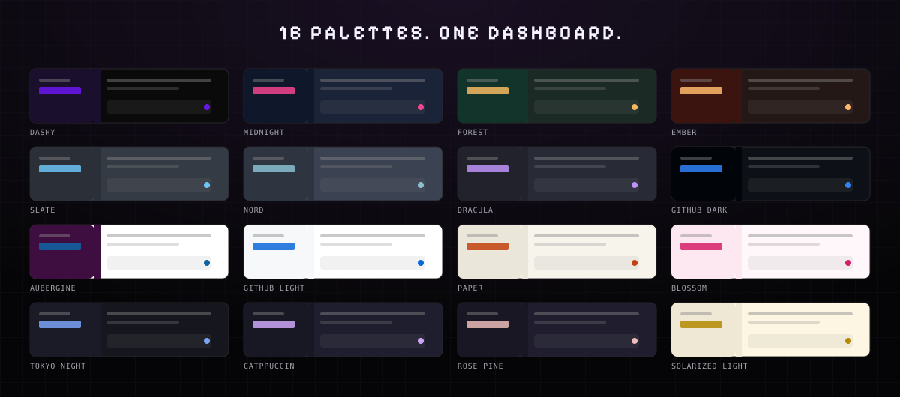

<div align="center">


# Dashy

**A self-hosted control plane for applications, databases, services, servers and virtual machines.**

One dashboard. Your own hardware. No agent on the machines you manage.

<a href="https://github.com/limoonsdev/dashy/stargazers"></a>
<a href="./LICENSE"></a>


[Quick start](#quick-start) · [Features](#features) · [Platforms](#platforms) · [Themes](#themes) · [Toolkit](#toolkit) · [Documentation](#documentation) · [中文](./docs/i18n/README.zh-cn.md) · [Français](./docs/i18n/README.fr.md) · [Español](./docs/i18n/README.es.md) · [Deutsch](./docs/i18n/README.de.md) · [日本語](./docs/i18n/README.ja.md)

</div>



---

## Overview

Dashy is a control plane you install once and keep. It deploys applications from Git, runs managed databases, installs one-click services, manages servers over SSH and provisions virtual machines on Proxmox VE — from a single black-first interface.

There is no agent to install on managed hosts. SSH is enough. If you stop using Dashy, your workloads keep running and stay manageable by hand, which is the difference between a control plane and a lock-in.

The fork keeps a deliberately small default footprint: a security baseline that is on by default, real theme support, a stateless chat bot and a network toolkit.

---

## Features

<table>
<tr>
<td width="50%" valign="top">

###  Applications
Deploy from GitHub, GitLab, Bitbucket or a Dockerfile. Nixpacks, Railpack, static builds and docker-compose are supported, with preview deployments per branch, rolling updates and instant rollback.

</td>
<td width="50%" valign="top">

###  Databases
PostgreSQL, MySQL, MariaDB, MongoDB, Redis, KeyDB, ClickHouse and Dragonfly. Scheduled backups to S3, one-click restore, and connection URLs ready for Prisma, Drizzle or Django.

</td>
</tr>
<tr>
<td valign="top">

###  One-click services
A catalogue of self-hosted software — from MinIO and Metabase to Jitsi and PeerTube — generated from a signed template bundle and deployable without writing a compose file.

</td>
<td valign="top">

###  Servers
Add any VPS over SSH. Dashy installs Docker, configures a proxy, reports metrics and keeps resources in sync without an agent.

</td>
</tr>
<tr>
<td valign="top">

###  Virtual machines
Pick a distribution, and Dashy sizes the VM, injects your SSH key, provisions cloud-init and starts it on Proxmox VE. The **DashyVMToolkit** script adds the guest agent, VirtIO tuning, discards and a serial console.

</td>
<td valign="top">

###  Security
Password and OAuth login, passkeys, audit log, per-team access grants, a malware scanner for uploads, and hardening scripts for UFW, fail2ban, CrowdSec and WireGuard.

</td>
</tr>
<tr>
<td valign="top">

###  Toolkit
Domain and DNS intelligence, archive import with stack detection, database URL builder, security command generator (John the Ripper, hashcat, Nmap, Hydra, Lynis, ClamAV), hash format identification and a Modrinth browser for Minecraft servers.

</td>
<td valign="top">

###  Operations
Scheduled jobs, webhooks, notifications, S3 storage, SSH terminal and container console, all wired into the same audit trail.

</td>
</tr>
</table>

---

## Platforms

Dashy runs on Linux, and manages workloads on any host reachable over SSH.

<table>
<tr>
<td align="center" width="16%"><br/>20.04+</td>
<td align="center" width="16%"><br/>11+</td>
<td align="center" width="16%"><br/>3.18+</td>
<td align="center" width="16%"><br/>rolling</td>
<td align="center" width="16%"><br/>39+</td>
<td align="center" width="16%"><br/>Leap 15.6</td>
</tr>
<tr>
<td align="center"><br/>9</td>
<td align="center"><br/>9</td>
<td align="center"><br/>9</td>
<td align="center"><br/>21+</td>
<td align="center"><br/>14</td>
<td align="center"><br/>WSL2</td>
</tr>
</table>

The control plane itself runs natively on Linux, in WSL2 on Windows, or in a Linux VM on macOS. Managed servers only need SSH.

---

## Quick start

```bash
curl -fsSL https://raw.githubusercontent.com/limoonsdev/dashy/main/scripts/install.sh | sudo bash
```

The installer checks the host, installs Docker when it is missing, builds or pulls the image, starts the stack and prints the dashboard URL. MongoDB and other optional dependencies are not required.

With docker-compose instead:

```bash
git clone https://github.com/limoonsdev/dashy.git
cd dashy
cp docker-compose.dev.yml docker-compose.yml   # or use the production compose file
docker compose up -d
```

Then open `http://<server>:8000` and create the first account. That account becomes the instance administrator.

---

## Themes

Dashy ships a real theming engine: four colors (sidebar, selection, accent, background) drive every surface, and the light or dark scheme is derived from the background rather than guessed. Twenty-eight presets are included — Dashy, Midnight, Forest, Ember, Slate, Nord, Dracula, GitHub Dark, GitHub Light, Aubergine, Paper, Blossom, Tokyo Night, Catppuccin, Rose Pine, Solarized Light, Kanagawa, Everforest, Gruvbox, Monokai, One Dark, Synthwave, Ocean, Sakura, Coffee, Mint, Blueprint and Cyberpunk.

A theme can be shared as a four-color code, so a team can reproduce the exact same interface in one paste.



---

## Toolkit

The toolkit is reachable from the sidebar and needs no extra service to run:

| Tool | What it does |
| --- | --- |
| Domain intelligence | RDAP lookup with WHOIS fallback, DNS records, and a warning when a hostname leaks the server IP |
| Hostname generator | Random labels on your own wildcard domain (`DASHY_WILDCARD_DOMAIN`), so generated URLs never embed an address |
| Archive import | Extracts a zip safely, reports the detected stack, and flags malware with the configured scanner |
| Database URLs | Builds Prisma, Drizzle, Django and raw connection strings with the right internal or public port |
| Hardening script | UFW, fail2ban, CrowdSec, anti-DDoS sysctl, WireGuard and telemetry blocking, generated for review |
| Security toolkit | John the Ripper, hashcat, Nmap, Hydra, Lynis, ClamAV and SSH auditing commands, plus hash format identification |
| Modrinth | Searches mods, plugins and datapacks and generates the download commands for a Minecraft server |
| DashyVMToolkit | Guest agent, VirtIO scheduler, zram and BBR tuning, TRIM timer, serial console and time sync for a VM |

Dashy never runs these scripts itself. Every generated file is displayed first, in full, so it can be read before it touches a server.

---

## Documentation

| Document | Contents |
| --- | --- |
| [Compatibility](docs/compatibility.md) | Supported hosts, databases and services |
| [Development](DEVELOPMENT.md) | Local setup, tests and the dev VM harness |
| [Contributing](CONTRIBUTING.md) | Conventions, helper image and release process |
| [Security](SECURITY.md) | Reporting a vulnerability |
| [Changelog](CHANGELOG.md) | Release history |

Translated guides: [Français](./docs/i18n/README.fr.md) · [Español](./docs/i18n/README.es.md) · [Deutsch](./docs/i18n/README.de.md) · [日本語](./docs/i18n/README.ja.md) · [简体中文](./docs/i18n/README.zh-cn.md)

---

## License

Apache-2.0. Dashy is an independent fork of the Coolify project; the upstream attribution is kept in [LICENSE](./LICENSE).
